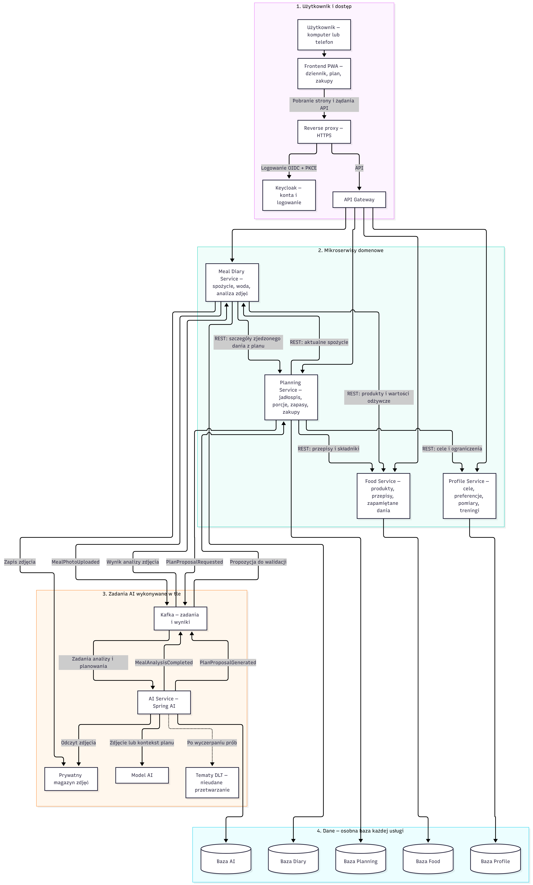

# NutriPlan

Aplikacja do prowadzenia dziennika żywieniowego i planowania diety, rozwijana w architekturze mikroserwisowej.

Projekt łączy Java i Spring Boot z komunikacją między usługami, osobnymi bazami danych, konteneryzacją oraz wdrożeniem na VPS przez GitLab CI/CD.

🌐 **[Strona projektu — nutriplan.com.pl](https://nutriplan.com.pl/)**

> Projekt jest w trakcie rozwoju. Opis rozdziela funkcje już zaimplementowane od architektury docelowej.

## Cel aplikacji

NutriPlan ma pomagać w kontrolowaniu codziennego odżywiania: rejestrowaniu posiłków, śledzeniu kalorii i makroskładników oraz planowaniu jadłospisów i zakupów.

Docelowo aplikacja będzie również analizować zdjęcia posiłków i generować propozycje planów żywieniowych z wykorzystaniem AI, uwzględniając cele i preferencje użytkownika.

## Dostępne funkcje

### Profil użytkownika

- Pobieranie i aktualizacja profilu.
- Przechowywanie podstawowych danych oraz celu żywieniowego.
- Rejestrowanie pomiarów masy ciała.

### Katalog produktów

- Dodawanie i pobieranie produktów spożywczych.
- Przechowywanie kalorii, białka, tłuszczów i węglowodanów na 100 g.
- Obliczanie wartości odżywczych dla wskazanej gramatury.

### Dziennik posiłków

- Dodawanie porcji produktu do wybranego dnia.
- Pobieranie wpisów według daty.
- Edycja i usuwanie wpisów.
- Dzienne podsumowanie kalorii i makroskładników.
- Pobieranie wartości porcji z `food-service` przez HTTP.
- Zapisywanie nazwy produktu i wartości porcji we wpisie, aby późniejsze zmiany katalogu nie zmieniały historii dziennika.

Obecnie profil i dziennik korzystają z tymczasowego identyfikatora `demo-user`. Rozdzielenie danych na podstawie zalogowanego użytkownika jest kolejnym etapem rozwoju.

## Obecna architektura

Projekt jest monorepozytorium Maven zawierającym trzy niezależnie uruchamiane mikroserwisy.

| Serwis | Odpowiedzialność | Port | Baza danych |
|---|---|---:|---|
| `profile-service` | Profil, cel żywieniowy i pomiary masy ciała | 8091 | `nutriplan_profile` |
| `food-service` | Katalog produktów i obliczanie wartości porcji | 8092 | `nutriplan_food` |
| `meal-diary-service` | Dziennik posiłków i podsumowania dnia | 8093 | `nutriplan_meal_diary` |

Każdy serwis ma własną bazę logiczną PostgreSQL oraz własne migracje Flyway. Bazy działają na wspólnej instancji PostgreSQL.

Serwisy nie odczytują bezpośrednio tabel innych usług. Dziennik pobiera dane porcji z katalogu produktów przez REST API.

### Przepływ dodawania posiłku

1. Klient wysyła UUID produktu, datę i gramaturę do `meal-diary-service`.
2. Dziennik wywołuje endpoint obliczania porcji w `food-service`.
3. Katalog zwraca nazwę produktu i wartości odżywcze dla wskazanej ilości.
4. Dziennik zapisuje wpis we własnej bazie.
5. API zwraca DTO zapisanego wpisu.

Odczyt historycznych wpisów i obliczanie podsumowania dnia odbywają się na podstawie bazy dziennika, bez ponownego pobierania wartości z katalogu.

### Organizacja kodu

| Warstwa | Rola |
|---|---|
| Controller | Obsługa żądań HTTP i walidacja danych wejściowych |
| Service | Logika aplikacji i granice transakcji |
| Repository | Dostęp do bazy danych |
| Entity | Odwzorowanie danych przechowywanych w bazie |
| DTO | Dane wejściowe i odpowiedzi API |
| Mapper | Mapowanie encji na DTO |
| Client | Komunikacja HTTP z innymi mikroserwisami |

## Architektura docelowa




### Użytkownik i dostęp

Użytkownik będzie korzystać z frontendu PWA na komputerze lub telefonie.

Reverse proxy będzie obsługiwać HTTPS i kierować ruch do odpowiednich komponentów. Keycloak będzie odpowiadać za uwierzytelnianie przez OIDC z PKCE, a API Gateway za przekazywanie żądań do mikroserwisów.

### Mikroserwisy domenowe

| Serwis | Docelowa odpowiedzialność |
|---|---|
| Profile Service | Profil, cele, preferencje, ograniczenia, pomiary i dane treningowe |
| Food Service | Produkty, wartości odżywcze, przepisy i zapamiętane dania |
| Meal Diary Service | Dziennik spożycia, woda i zlecanie analizy zdjęć |
| Planning Service | Jadłospisy, porcje, zapasy i listy zakupów |
| AI Service | Analiza zdjęć i generowanie propozycji planów |

Komunikacja REST będzie obsługiwać operacje wymagające bezpośredniej odpowiedzi, np. pobieranie produktów, przepisów, celów użytkownika i aktualnego spożycia.

Każda usługa zachowa własną bazę danych i odpowiedzialność za jej schemat.

### Zadania AI w tle

Dłuższe operacje będą wykonywane asynchronicznie z wykorzystaniem Apache Kafka.

1. Meal Diary Service zapisze zdjęcie w prywatnym magazynie i opublikuje `MealPhotoUploaded`.
2. Planning Service będzie zlecać przygotowanie propozycji przez `PlanProposalRequested`.
3. AI Service pobierze zadanie i potrzebne dane, a następnie wywoła model przez Spring AI.
4. Wyniki wrócą jako `MealAnalysisCompleted` lub `PlanProposalGenerated`.
5. Po wyczerpaniu prób nieudane zadania trafią do tematów DLT.

Wyniki analizy i propozycje planów będą podlegać walidacji przed zatwierdzeniem.

### Stan realizacji

Wdrożone są trzy podstawowe mikroserwisy: `profile-service`, `food-service` i `meal-diary-service`, wraz z bazami oraz pipeline GitLab CI/CD.

Diagram przedstawia architekturę docelową. Frontend PWA, Planning Service, AI Service, przepływy Kafka, API Gateway i integracja logowania z aplikacją są planowanymi etapami rozwoju.

## Technologie

### Obecnie wykorzystywane

| Obszar | Technologie |
|---|---|
| Język | Java 17 |
| Backend | Spring Boot 4.1.2, Spring MVC |
| Komunikacja usług | REST API, Spring RestClient |
| Dostęp do danych | Spring Data JPA, Hibernate |
| Baza danych | PostgreSQL |
| Migracje schematu | Flyway |
| Walidacja | Jakarta Bean Validation |
| Redukcja powtarzalnego kodu | Lombok |
| Budowanie projektu | Maven |
| Konteneryzacja | Docker, Docker Compose |
| Budowanie obrazów w CI | Rootless BuildKit |
| Automatyzacja | GitLab CI/CD |
| Rejestr obrazów | GitLab Container Registry |
| Hosting | VPS |
| Reverse proxy | Nginx |
| Certyfikaty HTTPS | Let's Encrypt / Certbot |
| Kontrola wersji | Git, GitLab, GitHub |

### Planowane technologie i integracje

- Frontend PWA.
- Keycloak: OIDC i PKCE.
- Weryfikacja tokenów i kontrola dostępu do danych użytkownika.
- API Gateway.
- Apache Kafka.
- Spring AI.
- Prywatny magazyn zdjęć.
- Mechanizmy ponawiania zadań i tematy DLT.

## GitLab CI/CD

Konfiguracja znajduje się w pliku [`.gitlab-ci.yml`](.gitlab-ci.yml).

Pipeline obejmuje trzy etapy: `verify`, `image` i `deploy`.

### Verify — budowanie i testy

- Równoległe zadania dla trzech modułów przez `parallel:matrix`.
- Osobny kontener PostgreSQL i baza testowa dla każdego zadania.
- Wykonanie `mvn clean verify` dla wybranego modułu oraz jego wymaganych zależności.
- Publikowanie raportów JUnit i plików JAR jako artefaktów.
- Cache lokalnego repozytorium Maven.

Oddzielne bazy testowe zapobiegają konfliktom historii migracji Flyway między usługami.

### Image — obrazy kontenerów

- Etap uruchamiany dla domyślnej gałęzi.
- Pobranie plików JAR z zadań weryfikacyjnych.
- Budowanie trzech obrazów przez rootless BuildKit.
- Oznaczanie obrazów pełnym SHA commita.
- Wysyłanie obrazów do GitLab Container Registry.

### Deploy — wdrożenie na VPS

- Ręczne uruchomienie zadania dla domyślnej gałęzi.
- Połączenie z VPS przez SSH.
- Pobranie obrazów odpowiadających commitowi bieżącego pipeline.
- Aktualizacja usług przez Docker Compose.
- Sprawdzenie odpowiedzi HTTP każdego serwisu.
- Zapis wersji obrazów w `.env` po poprawnym sprawdzeniu uruchomienia.

`resource_group` zapobiega równoczesnemu wykonywaniu wdrożeń produkcyjnych.

Obecna konfiguracja nie wykonuje automatycznego rollbacku. Jeżeli sprawdzenie uruchomienia zawiedzie, job zakończy się błędem, ale kontenery mogą już działać w nowej wersji.

### Zmienne wdrożeniowe

| Zmienna | Zastosowanie |
|---|---|
| `DEPLOY_HOST` | Adres serwera VPS |
| `DEPLOY_USER` | Użytkownik wykonujący wdrożenie |
| `SSH_PRIVATE_KEY` | Prywatny klucz SSH, zmienna GitLab typu File |
| `SSH_KNOWN_HOSTS` | Zweryfikowane klucze hosta, zmienna typu File |
| `CI_REGISTRY*` | Wbudowane zmienne GitLab do obsługi rejestru obrazów |

Hasła produkcyjne i klucze prywatne są konfiguracją środowiska i nie powinny trafiać do repozytorium.

## Środowisko VPS

Mikroserwisy działają jako kontenery zarządzane przez Docker Compose.

Konfiguracja wdrożeniowa znajduje się na serwerze w katalogu `/opt/nutriplan`:

| Element | Zastosowanie |
|---|---|
| `compose.app.yaml` | Definicje usług i ich konfiguracja |
| `.env` | Zmienne środowiskowe i wersje obrazów |
| PostgreSQL | Osobne bazy mikroserwisów |
| Nginx | Reverse proxy i HTTPS dla strony projektu |

W obecnej konfiguracji kontenery aplikacji korzystają z sieci hosta. Komunikacja dziennika z katalogiem produktów odbywa się przez lokalny adres VPS.

## Przykładowe API

Adresy poniżej dotyczą uruchomienia lokalnego.

| Metoda | Endpoint | Działanie |
|---|---|---|
| `GET` | `http://localhost:8092/api/foods` | Lista produktów |
| `GET` | `http://localhost:8092/api/foods/{id}/portion?grams=150` | Obliczenie wartości porcji |
| `POST` | `http://localhost:8093/api/meals` | Dodanie wpisu |
| `GET` | `http://localhost:8093/api/meals?date=2026-11-17` | Wpisy z wybranego dnia |
| `GET` | `http://localhost:8093/api/meals/summary?date=2026-11-17` | Podsumowanie dnia |
| `PUT` | `http://localhost:8093/api/meals/{id}` | Edycja wpisu |
| `DELETE` | `http://localhost:8093/api/meals/{id}` | Usunięcie wpisu |

### Dodanie lub edycja wpisu

```json
{
  "foodProductId": "9a2ee834-8255-4c7d-86ca-1bb2c8d3c20e",
  "eatenOn": "2026-11-17",
  "grams": 150
}
```

UUID produktu należy zastąpić identyfikatorem istniejącym w używanej bazie.

### Przykładowe podsumowanie dnia

```json
{
  "date": "2026-11-17",
  "entriesCount": 2,
  "calories": 540.00,
  "proteinGrams": 30.00,
  "fatGrams": 12.00,
  "carbsGrams": 78.00
}
```

### Obsługa błędów połączenia z katalogiem

| Sytuacja | Status zwracany przez dziennik |
|---|---|
| Produkt nie istnieje — katalog zwraca `404` | `404 Not Found` |
| Pusta odpowiedź katalogu | `502 Bad Gateway` |
| Inny błąd HTTP katalogu obsługiwany przez klienta | `502 Bad Gateway` |
| Błąd połączenia z katalogiem | `503 Service Unavailable` |

## Uruchomienie lokalne

### Wymagania

- JDK 17.
- Maven.
- PostgreSQL.
- Docker, jeśli baza będzie uruchamiana w kontenerze.

### Przygotowanie projektu

```bash
git clone https://github.com/gkowalczyk/nutri-plan-app.git
cd nutri-plan-app
```

Utwórz osobne bazy PostgreSQL:

- `nutriplan_profile`
- `nutriplan_food`
- `nutriplan_meal_diary`

Ustaw połączenie z właściwą bazą osobno dla każdego procesu aplikacji.

Przykładowe zmienne dla `meal-diary-service`:

```dotenv
SPRING_DATASOURCE_URL=jdbc:postgresql://localhost:5432/nutriplan_meal_diary
SPRING_DATASOURCE_USERNAME=nutriplan
SPRING_DATASOURCE_PASSWORD=<haslo>
FOOD_SERVICE_BASE_URL=http://localhost:8092
```

Adres i port PostgreSQL należy dopasować do własnego środowiska.

Konfiguracja klienta katalogu:

```properties
food-service.base-url=${FOOD_SERVICE_BASE_URL:http://localhost:8092}
```

Konfiguracja zarządzania schematem:

```properties
spring.jpa.hibernate.ddl-auto=validate
spring.jpa.open-in-view=false
```

Flyway wykonuje migracje, a Hibernate sprawdza zgodność encji ze schematem.

### Uruchomienie usług

Każde polecenie wykonaj w osobnym terminalu z odpowiednimi zmiennymi środowiskowymi.

```bash
mvn -pl profile-service spring-boot:run
```

```bash
mvn -pl food-service spring-boot:run
```

```bash
mvn -pl meal-diary-service spring-boot:run
```

`food-service` musi być dostępny podczas dodawania i edycji wpisów dziennika.

## Plan rozwoju

- [x] Podstawowy profil użytkownika i pomiary masy ciała.
- [x] Katalog produktów spożywczych.
- [x] Obliczanie wartości odżywczych porcji.
- [x] Dodawanie, odczyt, edycja i usuwanie wpisów dziennika.
- [x] Dzienne podsumowania kalorii i makroskładników.
- [x] Konteneryzacja trzech mikroserwisów.
- [x] GitLab CI/CD i wdrożenie na VPS.
- [ ] Logowanie i rozdzielenie danych użytkowników.
- [ ] Rozbudowa testów automatycznych.
- [ ] Frontend PWA.
- [ ] API Gateway.
- [ ] Planowanie jadłospisów, zapasów i zakupów.
- [ ] Analiza zdjęć posiłków.
- [ ] Przetwarzanie zadań AI przez Kafka.
- [ ] Integracje z danymi aktywności i powiadomieniami.

## Repozytoria

- **[GitLab](https://gitlab.com/gkowalczyk/nutri-plan-app)** — główne repozytorium i pipeline CI/CD.
- **[GitHub](https://github.com/gkowalczyk/nutri-plan-app)** — mirror projektu.

## Autor

**Grzegorz Kowalczyk**

Projekt rozwijany w ramach nauki projektowania, implementowania i wdrażania aplikacji mikroserwisowych.